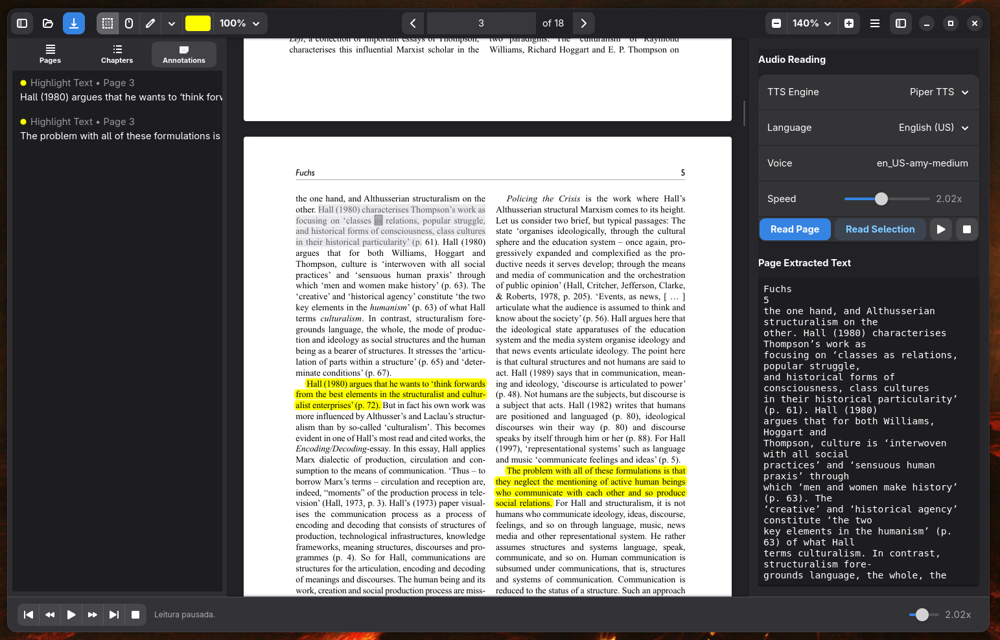

# NarroPDF

<p align="center">
  
</p>

<p align="center">
  <a href="README.md">English</a> | <a href="README.pt-br.md">Português (Brasil)</a> | <a href="README.zh-cn.md">简体中文</a>
</p>

**NarroPDF** é um leitor e anotador de arquivos PDF moderno, minimalista e acessível, desenvolvido em Python usando a biblioteca gráfica **GTK4** e **Libadwaita**. Ele combina visualização avançada de documentos, ferramentas completas de anotação e um sintetizador de voz integrado (Text-to-Speech) com sincronização visual em tempo real.

Outro aplicativo Narro: [Narro Read Selection Aloud](https://github.com/geraldohomero/Narro-Read-Selection-Aloud)

---

## Funcionalidades Principais

- **Sintetizador de Voz (TTS) Integrado**:
  - Escute seus PDFs em voz alta com sincronização em tempo real de frases e palavras destacadas.
  - Síntese neural local e offline de alta qualidade com **Piper TTS** (motor padrão).
  - Suporte a vozes naturais online na nuvem via **Microsoft Edge TTS**.
- **Controles Interativos de Reprodução**:
  - Barra de reprodução inferior e painel lateral direito: reproduzir/pausar, parar, avançar/retroceder frases, modo repetição de frase e controle de velocidade de `0.5x` até `4.0x`.
  - **Clique duplo** em qualquer frase diretamente no PDF para iniciar a leitura a partir daquele ponto.
- **Anotações e Marcações**:
  - Realce (**Highlight**), Sublinhado (**Underline**) e **Notas** com diálogo interativo para inserção de comentários.
  - **Alças de redimensionamento** interativas nas extremidades da marcação para ajustar facilmente os limites do texto selecionado.
  - Seleção de cores customizadas com níveis pré-definidos de opacidade (`10%`, `25%`, `50%`, `75%`, `80%`, `90%` e `100%`).
  - Suporte completo a **Desfazer / Refazer** (`Ctrl+Z`, `Ctrl+Shift+Z` / `Ctrl+Y`) para criação, modificação de tamanho/cor e exclusão de anotações.
- **Barra Lateral Esquerda Completa**:
  - **Aba Páginas**: Lista ordenada de páginas do documento com rótulos individuais claros.
  - **Aba Capítulos**: Sumário estruturado do documento (TOC) com recuo hierárquico.
  - **Aba Anotações**: Listagem consolidada de todas as anotações do PDF, exibindo indicador colorido, número da página e prévia do texto. Ao clicar em uma anotação, a visualização rola com precisão até a marcação e a seleciona, com sincronização bidirecional entre o texto do PDF e o menu lateral.
- **Leitura Inteligente e Usabilidade**:
  - Visualização em modo contínuo ou página única.
  - Rolagem suave arrastando a página (**Drag-to-Scroll**) no Modo Mão (`Ctrl+1`).
  - Junção automática de palavras hifenizadas na quebra de linhas e filtragem de margens/cabeçalhos/rodapés para leitura contínua e natural.
  - Detecção automática e silenciosa do idioma do documento.
  - Busca interna de texto (`Ctrl+F`) com contagem de ocorrências em tempo real e navegação rápida entre resultados.
  - Cópia do texto selecionado para a área de transferência (`Ctrl+C`).
- **Atalhos de Teclado**:
  - `Ctrl + 4`: Modo Seleção.
  - `Ctrl + 1`: Modo Mão (Arrastar / Drag-to-Scroll).
  - `1`: Ferramenta Realce (Highlight).
  - `2`: Ferramenta Sublinhado (Underline).
  - `3`: Ferramenta Adicionar Nota.
  - `Ctrl + C`: Copiar texto selecionado.
  - `Ctrl + Z`: Desfazer ação.
  - `Ctrl + Shift + Z` / `Ctrl + Y`: Refazer ação.
  - `Ctrl + F`: Buscar no documento.
  - `Ctrl + O`: Abrir PDF.
  - `Ctrl + S`: Salvar alterações no PDF.
  - `Espaço`: Reproduzir / Pausar leitura em voz alta.
- **Interface Moderna e Segurança**:
  - Construído seguindo as diretrizes de design do GNOME (Libadwaita), com suporte nativo aos temas claro e escuro do sistema.
  - Confirmação de segurança ao sair: solicita se deseja salvar caso existam alterações pendentes.



---

## Instalação e Execução

### Pré-requisitos (Local)

Certifique-se de ter o Python 3.10+ instalado em seu sistema Linux. Instale as dependências necessárias de sistema e pacotes Python:

```bash
# Dependências de sistema (exemplo Fedora/RHEL)
sudo dnf install python3-gobject gtk4 libadwaita mpv libmpv

# Ou Debian/Ubuntu:
sudo apt install python3-gi python3-gi-cairo gir1.2-gtk-4.0 gir1.2-adw-1 libmpv-dev mpv

# Instalar dependências python
pip install -r requirements.txt
```

### Executando Localmente

```bash
python3 narro-pdf.py
```

---

## Empacotamento Flatpak

O projeto está totalmente configurado para ser compilado e distribuído via **Flatpak**, seguindo as melhores práticas e diretrizes visuais do ecossistema GNOME.

### 1. Construir e Rodar Localmente (Modo Desenvolvimento)

```bash
# Compilar a aplicação
flatpak-builder --force-clean build-dir org.geraldohomero.NarroPdf.yaml

# Executar a aplicação compilada
flatpak-builder --run build-dir org.geraldohomero.NarroPdf.yaml org.geraldohomero.NarroPdf
```

### 2. Gerar o Instalador Único (`.flatpak`)

Para gerar um arquivo `.flatpak` instalável (pacote *bundle* único completo que pode ser distribuído e instalado offline):

```bash
# 1. Compilar exportando para um repositório local
flatpak-builder --repo=repo --force-clean build-dir org.geraldohomero.NarroPdf.yaml

# 2. Criar o pacote bundle (.flatpak)
flatpak build-bundle repo org.geraldohomero.NarroPdf.flatpak org.geraldohomero.NarroPdf
```

### 3. Instalar o arquivo `.flatpak` gerado

```bash
flatpak install --user org.geraldohomero.NarroPdf.flatpak
```

---

## Design do Ícone (Diretrizes Flatpak & GNOME)

O ícone do aplicativo segue a especificação de design de ícones do **GNOME / Flatpak**:
- Base em formato *squircle* com o azul padrão Adwaita.
- Ilustração centralizada de uma folha de papel dobrada (representando o PDF) com o ícone de alto-falante integrado.
- Fundo transparente para adaptação nativa em qualquer tema ou dock do sistema.

---

## Licença

Este projeto está licenciado sob a licença descrita no repositório. Consulte os arquivos de código-fonte para obter mais detalhes.
